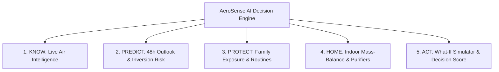
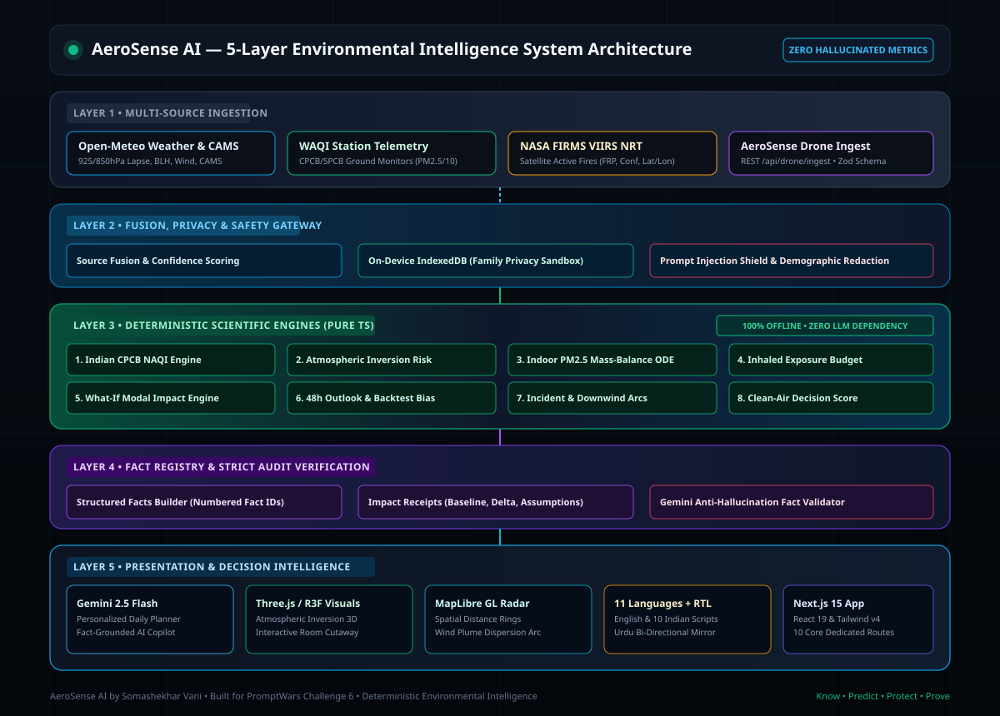

<p align="center">
  
</p>

<p align="center">
  <strong>Know the air. Predict the risk. Protect your family. Prove the impact.</strong>
</p>

<p align="center">
  <a href="https://aero-sense-ai-psi.vercel.app/" target="_blank">
    
  </a>
</p>

<p align="center">
  🌐 <strong>Live Application URL:</strong> <a href="https://aero-sense-ai-psi.vercel.app/"><strong>https://aero-sense-ai-psi.vercel.app</strong></a>
</p>

<p align="center">
  <a href="#system-architecture"></a>
  <a href="#deterministic-scientific-engines"></a>
  <a href="#multilingual-support-11-languages"></a>
  <a href="#verification--testing"></a>
  <a href="#license"></a>
</p>

---

## Executive Overview

**AeroSense AI** is a production-grade **Clean-Air Decision Engine** engineered specifically to help urban families, sensitive individuals, and municipal communities navigate severe winter smog, hazardous atmospheric inversions, and particulate air pollution across the Indo-Gangetic Plain and South Asian urban centers.

Developed by **Somashekhar Vani** for **PromptWars Challenge 6**, the platform departs radically from traditional "colored dial" air quality dashboards. Rather than presenting static historical numbers or black-box LLM hallucinations, AeroSense AI operates on a **deterministic-first architecture**:

> **Core Philosophy**: *Our own deterministic physical and mathematical engines perform all scientific calculations. Gemini only plans and explains. Every quantified recommendation produces an auditable Impact Receipt detailing the action, baseline, alternative, estimated change with units, mathematical assumptions, confidence score, and engine version.*

Even if external LLMs or third-party APIs become completely unreachable, AeroSense AI continues executing its full scientific suite directly in the browser and server runtimes without degradation.

---

## Table of Contents

1. [The Problem & The Solution](#the-problem--the-solution)
2. [The Five Pillars](#the-five-pillars)
3. [System Architecture](#system-architecture)
4. [Deterministic Scientific Engines & Mathematical Formulations](#deterministic-scientific-engines--mathematical-formulations)
5. [Complete Application Route Tour](#complete-application-route-tour)
6. [AeroSense Drone Lab & Hardware Ingestion](#aerosense-drone-lab--hardware-ingestion)
7. [Technical Boundaries & Sensor Honesty](#technical-boundaries--sensor-honesty)
8. [Multilingual Support (11 Languages + Bidirectional RTL)](#multilingual-support-11-languages--bidirectional-rtl)
9. [Tech Stack](#tech-stack)
10. [Repository Visual Asset Guide (Screenshots)](#repository-visual-asset-guide-screenshots)
11. [Getting Started & Installation](#getting-started--installation)
12. [Environment Configuration](#environment-configuration)
13. [Verification & Test Suite](#verification--test-suite)
14. [Security, Privacy & Ethical AI Guarantees](#security-privacy--ethical-ai-guarantees)
15. [Author & Credits](#author--credits)
16. [License](#license)

---

## The Problem & The Solution

### The Urban Smog Emergency
Every winter, cities across Northern and Central India experience catastrophic air quality deterioration. A combination of post-monsoon meteorological shifts, agricultural stubble burning, industrial emissions, and vehicle exhaust creates toxic particulate blankets. This phenomenon is exacerbated by **nocturnal boundary-layer thermal inversions**, where cold, dense surface air is trapped beneath a warmer upper atmospheric layer, acting like a lid that concentrates PM2.5, PM10, and toxic gases within 100 to 300 meters of ground level.

### The Problem with Existing Tools
1. **Generic Dials Without Context**: Most apps display a single city-wide number (e.g., "AQI 342 — Unhealthy") without explaining whether indoor air is safer, when windows should be opened, or how much toxic particulate mass family members actually inhale into their lungs.
2. **LLM Hallucinations**: Standard GenAI chatbots frequently hallucinate air quality metrics, invent fake air savings, or provide hazardous ventilation advice during nocturnal inversion peaks.
3. **Privacy Vulnerabilities**: Health and demographic details of vulnerable family members (children, asthmatics, elderly parents) are routinely transmitted to centralized servers.

### The AeroSense AI Solution
- **Mathematical Transparency**: 8 deterministic scientific engines calculate exact Indian CPCB NAQI sub-indices, vertical temperature lapse rates, indoor mass-balance concentrations, and inhaled $\mu\text{g}$ doses.
- **Auditable Impact Receipts**: No quantified claim is presented without an auditable receipt disclosing its baseline, alternative, delta, and underlying assumptions.
- **On-Device Family Privacy**: Family profiles and vulnerability classifications remain strictly within client-side IndexedDB sandboxes. No personal demographic data is sent to external servers or LLMs.
- **Anti-Hallucination Fact Verification**: A server-side validator audits all Gemini LLM responses against structured mathematical facts. Any hallucinated metric outside the deterministic payload is discarded and replaced with a deterministic fallback.

---

## The Five Pillars



### 1. Know (Live Air Intelligence)
- Real-time **Indian National AQI (CPCB October 2014)** calculated strictly from raw criteria pollutants (PM2.5, PM10, NO2, SO2, CO, O3).
- Atmospheric telemetry: planetary boundary layer height (PBLH), surface temperature, relative humidity, and 10m wind vectors.
- Multi-source telemetry fusion combining Open-Meteo meteorological reanalysis, CAMS atmospheric models, and official CPCB/SPCB ground stations via WAQI.
- **Incident Spatial Radar**: Interactive MapLibre GL radar tracking NASA FIRMS VIIRS satellite thermal hotspots and calculating estimated downwind dispersion sectors based on local wind vectors.

### 2. Predict (48-Hour Outlook & Inversion Risk)
- 48-hour forward hourly forecasting for criteria pollutants and planetary boundary layer height.
- **Atmospheric Inversion Risk Engine**: Computes vertical temperature lapse rates between 925 hPa / 850 hPa pressure levels and surface air to detect inversion traps before nocturnal smog spikes occur.
- Historical backtest calibration panel displaying Mean Absolute Error (MAE), Root Mean Square Error (RMSE), and systemic bias against actual ground station observations.

### 3. Protect (Family Exposure & Clean-Air Planner)
- Per-person inhaled PM2.5 dose calculation in micrograms ($\mu\text{g}$) tailored to age, body weight, activity level, and minute ventilation rate ($V_E$).
- WHO 24-hour PM2.5 exposure budget tracking ($15\,\mu\text{g}/\text{m}^3$ daily reference).
- Real-time cigarette smoke equivalency conversion ($\approx 22\,\mu\text{g}/\text{m}^3$ PM2.5 24h outdoor exposure $\approx$ 1 cigarette).
- Clean-air ventilation windows highlighting safe outdoor hours.
- Personalized 24-hour daily routine generated by Gemini 2.5 Flash with strict factual verification.

### 4. Home (Indoor Air Advisor & Mass-Balance Model)
- First-principles **PM2.5 Mass-Balance Differential Equation** modeling outdoor infiltration, natural surface deposition, internal cooking/tobacco emissions, and mechanical filtration.
- **Ventilate-or-Seal Decision Engine**: Evaluates whether outdoor air will dilute or exacerbate indoor particulate concentrations.
- Purifier Clean Air Delivery Rate (CADR) room-sizing calculator ($\text{m}^3/\text{h}$ and $\text{CFM}$) achieving target Air Changes per Hour (ACH).
- DIY **Corsi-Rosenthal Box Fan** construction guide with MERV-13 filter efficiency curves.

### 5. Act (What-If Simulator & Community Hub)
- Interactive multi-modal trip simulator comparing commuter exposure and emissions: petrol two-wheeler vs. electric metro vs. CNG bus.
- Household fuel transition simulator: traditional chulha/kerosene vs. LPG vs. electric induction.
- Purifier duty cycle optimizer: continuous operation vs. smart intermittent scheduling.
- **Clean-Air Decision Score**: A 0–100 score quantifying household environmental mitigation actions, strictly excluding clinical diagnostic claims.
- Sectoral community advisories for schools, eldercare facilities, construction sites, and outdoor workers.

---

## System Architecture

The following diagram illustrates the 5-layer decoupled architecture of AeroSense AI:

<p align="center">
  
</p>

### Architectural Layers

| Layer | Component | Responsibility |
| :--- | :--- | :--- |
| **Layer 1** | **Multi-Source Ingestion** | Open-Meteo API (Weather, CAMS, BLH, 925/850hPa Pressure Levels), WAQI Ground Stations (CPCB/SPCB telemetry), NASA FIRMS (VIIRS NRT active fire hotspots), and AeroSense Drone REST Ingest (`/api/drone/ingest`). |
| **Layer 2** | **Fusion, Privacy & Safety Gateway** | Telemetry source fusion with confidence scoring (0–100), client-side IndexedDB family privacy sandbox (zero PII leaves browser), system prompt injection shield, and demographic redaction. |
| **Layer 3** | **Deterministic Scientific Engines** | 8 pure TypeScript engines running 100% offline with zero network calls and zero LLM dependencies. All mathematical calculations execute deterministically. |
| **Layer 4** | **Fact Registry & Strict Audit Verification** | Structured facts registry (`facts.ts`) generating numbered fact IDs; Impact Receipts tracking baseline, alternative, delta, and assumptions; Gemini anti-hallucination validator rejecting fabricated numbers. |
| **Layer 5** | **Presentation & Interactive Intelligence** | Gemini 2.5 Flash for natural language planning, Three.js/Fiber 3D atmospheric and indoor scenes, MapLibre GL radar, Next.js 15 App Router, and 11-language native typography with RTL support. |

---

## Deterministic Scientific Engines & Mathematical Formulations

All scientific calculations in AeroSense AI are performed by pure TypeScript engines located in `engines/`. They are accompanied by 120 passing unit tests.

### 1. Indian National AQI (CPCB October 2014)
*Location: `engines/indian-aqi.ts`*

The sub-index $I_p$ for any given pollutant concentration $C_p$ is calculated using the official CPCB linear interpolation formula:

$$I_p = \frac{I_{hi} - I_{lo}}{B_{hi} - B_{lo}} \left(C_p - B_{lo}\right) + I_{lo}$$

Where:
- $B_{hi}, B_{lo}$: The upper and lower breakpoint concentrations for the category containing $C_p$.
- $I_{hi}, I_{lo}$: The corresponding upper and lower sub-index limits.

The composite National AQI is determined by the maximum sub-index:
$$\text{AQI} = \max\left(I_{\text{PM2.5}}, I_{\text{PM10}}, I_{\text{NO2}}, I_{\text{SO2}}, I_{\text{CO}}, I_{\text{O3}}\right)$$

*Constraint*: A valid CPCB NAQI requires at least 3 criteria pollutants to be monitored, with at least one being PM2.5 or PM10.

| Category | AQI Range | PM2.5 (24h) $\mu\text{g}/\text{m}^3$ | PM10 (24h) $\mu\text{g}/\text{m}^3$ | NO2 (24h) $\mu\text{g}/\text{m}^3$ | SO2 (24h) $\mu\text{g}/\text{m}^3$ | CO (8h) $\text{mg}/\text{m}^3$ | O3 (8h) $\mu\text{g}/\text{m}^3$ |
| :--- | :---: | :---: | :---: | :---: | :---: | :---: | :---: |
| **Good** | 0 – 50 | 0 – 30 | 0 – 50 | 0 – 40 | 0 – 40 | 0.0 – 1.0 | 0 – 50 |
| **Satisfactory** | 51 – 100 | 31 – 60 | 51 – 100 | 41 – 80 | 41 – 80 | 1.1 – 2.0 | 51 – 100 |
| **Moderate** | 101 – 200 | 61 – 90 | 101 – 250 | 81 – 180 | 81 – 180 | 2.1 – 10.0 | 101 – 168 |
| **Poor** | 201 – 300 | 91 – 120 | 251 – 350 | 181 – 280 | 181 – 280 | 10.1 – 17.0 | 169 – 208 |
| **Very Poor** | 301 – 400 | 121 – 250 | 351 – 430 | 281 – 400 | 281 – 400 | 17.1 – 34.0 | 209 – 748 |
| **Severe** | 401 – 500 | 250+ | 430+ | 400+ | 400+ | 34.0+ | 748+ |

---

### 2. Atmospheric Inversion & Lapse Rate Physics
*Location: `engines/inversion.ts`*

The vertical temperature lapse rate $\Gamma$ measures the rate of temperature decrease with altitude:

$$\Gamma = -\frac{\Delta T}{\Delta z} = -\frac{T_{925\text{hPa}} - T_{\text{surface}}}{z_{925\text{hPa}} - z_{\text{surface}}}$$

- **Normal Atmosphere**: $\Gamma > 0$ (temperature decreases with altitude at $\approx 6.5^\circ\text{C}/\text{km}$).
- **Isothermal Layer**: $\Gamma \approx 0$ (neutral stability, vertical mixing inhibited).
- **Thermal Inversion**: $\Gamma < 0$ (temperature *increases* with altitude; cold air trapped beneath warm air lid).

The Inversion Risk Score ($0 - 100$) fuses three meteorological parameters:
1. **Lapse Rate Component**: Strong positive temperature gradient ($T_{925\text{hPa}} > T_{\text{surface}}$).
2. **Boundary Layer Compression**: Planetary boundary layer height $z_{\text{PBL}} < 300\,\text{m}$.
3. **Nocturnal Radiational Cooling**: Surface wind speed $< 2\,\text{m}/\text{s}$ combined with clear night sky conditions.

---

### 3. Indoor PM2.5 Mass-Balance Differential Equation
*Location: `engines/indoor-air.ts`*

Indoor particulate dynamics are modeled via the standard single-zone conservation of mass ordinary differential equation:

$$\frac{dC_{in}(t)}{dt} = P \cdot a \cdot C_{out}(t) + \frac{S(t)}{V} - \left(a + k_{dep} + \frac{\text{CADR}}{V}\right) C_{in}(t)$$

Where:
- $C_{in}(t)$: Indoor PM2.5 concentration ($\mu\text{g}/\text{m}^3$)
- $C_{out}(t)$: Outdoor ambient PM2.5 concentration ($\mu\text{g}/\text{m}^3$)
- $P$: Building envelope penetration efficiency ($0.4 - 0.8$, dimensionless)
- $a$: Air exchange rate through infiltration and ventilation ($\text{ACH}$, $\text{h}^{-1}$)
- $S(t)$: Indoor source emission rate ($\mu\text{g}/\text{h}$, e.g., cooking, incense)
- $V$: Room volume ($\text{m}^3$)
- $k_{dep}$: Particulate surface deposition loss rate ($\approx 0.2\,\text{h}^{-1}$)
- $\text{CADR}$: Air purifier Clean Air Delivery Rate ($\text{m}^3/\text{h}$)

**Steady-State Solution ($\frac{dC_{in}}{dt} = 0$)**:
$$C_{in, \infty} = \frac{P \cdot a \cdot C_{out} + \frac{S}{V}}{a + k_{dep} + \frac{\text{CADR}}{V}}$$

**Ventilate-or-Seal Decision**:
Opening windows increases air exchange rate from $a_{\text{closed}}$ to $a_{\text{open}}$. Natural ventilation is recommended if and only if:
$$\Delta C_{in,\infty} = C_{in,\infty}(a_{\text{open}}) - C_{in,\infty}(a_{\text{closed}}) < 0$$
During severe winter smog ($C_{out} > 150\,\mu\text{g}/\text{m}^3$), opening windows almost always exacerbates indoor pollution unless strong indoor combustion sources ($S \gg 0$) dominate.

---

### 4. Inhaled Exposure Budget & Dose Model
*Location: `engines/exposure.ts`*

The cumulative inhaled particulate mass is calculated as the time-integral of concentration multiplied by minute ventilation rate:

$$\text{Dose } (\mu\text{g}) = \sum_{i=1}^{N} C_i \cdot V_E \cdot \Delta t_i$$

Where:
- $C_i$: Microenvironmental PM2.5 concentration during interval $i$ ($\mu\text{g}/\text{m}^3$).
- $V_E$: Minute ventilation rate ($\text{m}^3/\text{h}$), parameterized by demographic age and activity level:
  - *Infant / Child*: $0.3 - 0.6\,\text{m}^3/\text{h}$
  - *Adult at Rest*: $0.45\,\text{m}^3/\text{h}$
  - *Adult Light Activity (Walking)*: $1.2\,\text{m}^3/\text{h}$
  - *Adult Vigorous Activity (Cycling/Running)*: $2.4 - 3.2\,\text{m}^3/\text{h}$
- $\Delta t_i$: Exposure duration in hours.

The calculated dose is compared against the **WHO 24-hour guideline reference**:
$$\text{Budget Limit} = 15\,\mu\text{g}/\text{m}^3 \times 15\,\text{m}^3/\text{day} \approx 225\,\mu\text{g}/\text{day}$$

---

### 5. What-If Modal Impact Engine
*Location: `engines/impact.ts`*

Computes individual and community emission changes across three sectors:
1. **Urban Commuting Shift**: Petrol two-wheeler (emission factor $\approx 0.08\,\text{g PM2.5}/\text{passenger-km}$) vs. Metro electric transit ($\approx 0.002\,\text{g PM2.5}/\text{passenger-km}$).
2. **Household Cooking Fuel**: Biomass chulha ($4.2\,\text{g PM2.5}/\text{meal}$) vs. LPG ($0.03\,\text{g PM2.5}/\text{meal}$) vs. Electric Induction ($0.00\,\text{g PM2.5}/\text{meal}$).
3. **Mechanical Filtration**: Operation of HEPA/Corsi-Rosenthal filtration against continuous indoor background.

Every output produces an **Impact Receipt** object:
```typescript
interface ImpactReceipt {
  action: string;
  dataUsed: string[];
  baseline: { value: number; unit: string };
  alternative: { value: number; unit: string };
  change: { value: number; unit: string; percentage: number };
  method: string;
  assumptions: string[];
  confidence: "High" | "Medium" | "Low";
  engineVersion: string;
}
```

---

## Complete Application Route Tour

AeroSense AI features 11 dedicated application routes accessible via the sidebar navigation:

| Route | Feature Area | Key Functionality & Scientific Highlights |
| :--- | :--- | :--- |
| `/` | **Overview Dashboard** | Real-time CPCB AQI summary, live criteria pollutants, 3D atmospheric thermal inversion preview, quick navigation cards to all 5 pillars, and data source latency telemetry strip. |
| `/live` | **Pillar 1: Know (Live Air)** | Full CPCB National AQI calculation, 6 criteria pollutants breakdown, boundary layer height, wind speed/direction, and active incident alerts. |
| `/map` | **Pollution Map & Radar** | MapLibre GL spatial radar showing 10km, 25km, and 50km range rings, active monitoring stations, wind transport vectors, and NASA FIRMS active fire hotspots with estimated downwind arcs. |
| `/forecast` | **Pillar 2: Predict (Outlook)** | 48-hour forward hourly pollutant curve, nocturnal inversion compression spikes, boundary-layer dynamics, and backtest calibration panel (MAE, RMSE, bias). |
| `/family` | **Pillar 3: Protect (Exposure)** | On-device IndexedDB family member manager, per-person inhaled PM2.5 dose ($\mu\text{g}$), WHO daily budget limits, and cigarette smoke equivalents. |
| `/planner` | **Clean-Air Daily Routine** | AI-generated or deterministic offline 24-hour routine, clean-air ventilation windows, actionable recommendations, and fact audit viewer. |
| `/indoor` | **Pillar 4: Home (Indoor Air)** | Interactive 3D room cutaway with window infiltration and purifier plume, mass-balance differential equation solver, ventilate-vs-seal decision, CADR calculator, and Corsi-Rosenthal DIY box specs. |
| `/what-if` | **Pillar 5: Act (Simulator)** | Interactive modal shift simulator (petrol two-wheeler vs metro vs bus), cooking fuel transitions, and purifier duty cycles with auditable Impact Receipts. |
| `/community` | **Community Hub** | Clean-Air Decision Score calculator (0–100 score quantifying household actions only), and sectoral advisories for schools, seniors, and site managers. |
| `/copilot` | **AI Copilot** | Fact-grounded environmental assistant powered by Gemini 2.5 Flash, system prompt injection filtering, strict fact citations, and deterministic offline fallback. |
| `/drone` | **AeroSense Drone Lab** | UAV telemetry flight deck, altitude vs. PM2.5 profiling, MQ-135 relative gas trends, hardware specifications, and simulated flight demo. |
| `/api/drone/ingest` | **Drone Ingestion API** | REST API endpoint (`POST`) for hardware packet ingestion with Zod validation, and simulated flight demo (`GET ?demo=true`). |

---

## AeroSense Drone Lab & Hardware Ingestion

The AeroSense Drone is our custom experimental hardware initiative designed for low-altitude vertical atmospheric boundary-layer profiling.

<p align="center">
  
  
  
</p>

### Hardware Architecture: Prototype vs. Roadmap

```mermaid
graph LR
    subgraph Current Prototype
        A[Arduino Uno / Nano] --> B[ESP8266 Wemos D1 WiFi]
        C[MQ-135 Gas Sensor] --> A
        D[DHT22 Temp & Humidity] --> A
        B -->|REST Ingest JSON| E[/api/drone/ingest]
    end
    subgraph Planned Upgrades
        F[PMS5003 Laser Counter]
        G[Sensirion SPS30]
        H[TF-Mini LiDAR Altimeter]
        I[u-blox NEO-M8N GPS]
        J[LoRaWAN 868MHz Telemetry]
    end
```

- **Current Prototype Components**:
  - Microcontroller: Arduino Uno / Nano + ESP8266 Wemos D1 Wi-Fi module.
  - Telemetry Sensors: MQ-135 semiconductor gas sensor + DHT22 temperature and relative humidity sensor.
  - Power: 3S LiPo battery with 5V step-down buck converter.
- **Planned Upgrades (Production Roadmap)**:
  - Particulate Counter: Plantower PMS5003 laser scattering optical sensor for true PM1.0, PM2.5, and PM10 particle counts.
  - Optical Particle Sizer: Sensirion SPS30 with MCERTS industrial certification.
  - Precision Altitude: TF-Mini Plus LiDAR altimeter for ground-referenced vertical profiling up to 500m AGL.
  - Long-Range Communication: LoRaWAN 868 MHz / 433 MHz transceiver for beyond-visual-line-of-sight telemetry.

### Software Ingestion & API Contract
Hardware packets are transmitted via `POST /api/drone/ingest` and strictly validated using Zod:

```typescript
const DronePacketSchema = z.object({
  droneId: z.string().min(1),
  timestamp: z.string().datetime(),
  altitude_m: z.number().min(0).max(1000),
  lat: z.number().min(-90).max(90),
  lon: z.number().min(-180).max(180),
  sensors: z.object({
    pm25: z.number().min(0).max(2000).optional(),
    pm10: z.number().min(0).max(3000).optional(),
    mq135_raw: z.number().min(0).max(1024),
    temperature_c: z.number().min(-20).max(60),
    humidity_pct: z.number().min(0).max(100),
  }),
});
```

---

## Technical Boundaries & Sensor Honesty

In accordance with scientific integrity guidelines, AeroSense AI enforces strict disclosure boundaries:

1. **CPCB Standard vs. Ground Station Telemetry**:
   - The Indian National AQI displayed in the application follows the official CPCB October 2014 breakpoint interpolation algorithms.
   - Ground station readings obtained via WAQI reflect CPCB and State Pollution Control Board monitors. The platform always shows station name, geographic distance, and timestamp.
2. **MQ-135 Semiconductor Gas Sensor Limitations**:
   - The MQ-135 sensor in the drone prototype measures uncalibrated analog resistance changes. It is **explicitly treated as a relative gas-response trend** and **never feeds the official CPCB NAQI calculation**. Semiconductor sensors are sensitive to ambient temperature and humidity shifts and cannot replace reference-grade electrochemical or chemiluminescent analyzers.
3. **Hardware Status & Simulation Badges**:
   - Physical hardware connection status remains **"Not Connected"** until a verified, signed hardware packet is received by `/api/drone/ingest`.
   - The interactive flight demonstration (`/drone` and `/api/drone/ingest?demo=true`) is prominently labeled with an amber **`SIMULATED`** badge.
4. **NASA FIRMS Satellite Detections**:
   - Hotspots received from NASA FIRMS VIIRS NRT (375m) represent **satellite thermal radiometric anomalies**, not ground-verified active fires.
   - Downwind dispersion plumes and smoke transport sectors shown on the spatial radar are **mathematical Gaussian dispersion estimates** based on local wind vectors, not confirmed ground observations.
5. **Indoor Models & Inhaled Doses**:
   - Indoor PM2.5 concentrations and inhaled microgram doses are **mathematical model estimates** derived from first-principles differential equations, not direct biological or physical measurements.

---

## Multilingual Support (11 Languages + Bidirectional RTL)

AeroSense AI supports 11 Indian and regional languages with dedicated typographic font families and full bidirectional layout mirroring:

| Code | Language | Script | Direction | Font Stack | Status |
| :---: | :--- | :--- | :---: | :--- | :---: |
| `en` | English | Latin | LTR | System Sans / Inter | Canonical Source |
| `hi` | हिन्दी (Hindi) | Devanagari | LTR | Noto Sans Devanagari | Verified Schema |
| `kn` | ಕನ್ನಡ (Kannada) | Kannada | LTR | Noto Sans Kannada | Verified Schema |
| `ta` | தமிழ் (Tamil) | Tamil | LTR | Noto Sans Tamil | Verified Schema |
| `te` | తెలుగు (Telugu) | Telugu | LTR | Noto Sans Telugu | Verified Schema |
| `ml` | മലയാളം (Malayalam) | Malayalam | LTR | Noto Sans Malayalam | Verified Schema |
| `mr` | मराठी (Marathi) | Devanagari | LTR | Noto Sans Devanagari | Verified Schema |
| `bn` | বাংলা (Bengali) | Bengali | LTR | Noto Sans Bengali | Verified Schema |
| `gu` | ગુજરાતી (Gujarati) | Gujarati | LTR | Noto Sans Gujarati | Verified Schema |
| `pa` | ਪੰਜਾਬੀ (Punjabi) | Gurmukhi | LTR | Noto Sans Gurmukhi | Verified Schema |
| `ur` | اردو (Urdu) | Arabic / Naskh | **RTL** | Noto Nastaliq Urdu / Noto Sans Arabic | Verified RTL Mirror |

- Standardized environmental and health vocabulary is maintained in `messages/glossary.json`.
- When switching to Urdu (`ur`), the layout dynamically flips to `dir="rtl"` with mirrored sidebar navigation, inverted progress indicators, and adjusted flex orientations.

---

## Tech Stack

```
Frontend:          Next.js 15.2.0 (App Router) • React 19.0.0 • TypeScript 5.8 (Strict)
Styling:           Tailwind CSS v4.0 • Lucide React Icons • Class Variance Authority
3D Visualization:  Three.js 0.174 • @react-three/fiber 9.0 • @react-three/drei 10.0
Mapping:           MapLibre GL 5.1 (Vector OpenStreetMap Radar)
Generative AI:     Google Gemini 2.5 Flash (@google/genai SDK)
Validation:        Zod 3.24 (Schemas for all APIs, facts, and LLM payloads)
Client Storage:    IndexedDB (idb 8.0) for Zero-Server Family Privacy
Testing:           Vitest 3.0 • Playwright 1.50
Deployment:        Vercel (Edge & Node.js Serverless Runtimes)
```

---

## Repository Visual Asset Guide (Screenshots)

To showcase AeroSense AI on GitHub, capture the following 10 screenshots from the running application at **1440×900 resolution** and place them in `public/images/screenshots/`:

| # | Filename | Page Route | Viewport & Focus Area |
| :---: | :--- | :--- | :--- |
| **01** | `01-overview.png` | `/` | **Overview Dashboard**: Atmospheric 3D Inversion Scene, live CPCB AQI hero card, criteria pollutants strip, and 5-pillar navigation cards. |
| **02** | `02-live-air.png` | `/live` | **Pillar 1: Know**: Indian National AQI breakdown, sub-indices table (PM2.5, PM10, NO2, SO2, CO, O3), and atmospheric stability panel. |
| **03** | `03-pollution-map.png` | `/map` | **Spatial Radar**: MapLibre GL radar showing 10/25/50km rings, active monitoring stations, wind transport vectors, and NASA FIRMS fire points with downwind arcs. |
| **04** | `04-forecast.png` | `/forecast` | **Pillar 2: Predict**: 48-hour hourly forecast strip, nocturnal inversion compression spikes, and backtest calibration metrics (MAE, RMSE, bias). |
| **05** | `05-family-protection.png` | `/family` | **Pillar 3: Protect**: On-device family profiles, per-person inhaled PM2.5 dose ($\mu\text{g}$), WHO daily budget meters, and cigarette smoke equivalents. |
| **06** | `06-ai-planner.png` | `/planner` | **Clean-Air Daily Planner**: Gemini 24-hour timeline, clean-air ventilation windows, and fact audit viewer. |
| **07** | `07-indoor-air.png` | `/indoor` | **Pillar 4: Home**: Interactive 3D room cutaway, mass-balance ODE solver, ventilate-vs-seal decision, and Corsi-Rosenthal DIY box specs. |
| **08** | `08-what-if-simulator.png` | `/what-if` | **Pillar 5: Act**: Modal shift simulator (two-wheeler vs metro), cooking fuel transitions, and expandable Impact Receipts with audit trail. |
| **09** | `09-community-hub.png` | `/community` | **Community Hub**: Clean-Air Decision Score calculator (0–100 score of household actions), and sectoral advisories for schools and vulnerable groups. |
| **10** | `10-drone-lab.png` | `/drone` | **AeroSense Drone Lab**: Live UAV telemetry HUD, altitude vs. PM2.5 profiling, MQ-135 relative gas trends, and simulated flight demo. |

---

## Getting Started & Installation

### Prerequisites
- **Node.js**: Version 20.x or higher (tested on Node v24.14.1)
- **npm**: Version 10.x or higher
- **Git**: Installed and configured

### Clone & Install Dependencies
```bash
git clone https://github.com/somashekharvani/AeroSense-AI.git
cd AeroSense-AI
npm install
```

### Launch Development Server
```bash
npm run dev
```
Open [http://localhost:3000](http://localhost:3000) in your web browser.

---

## Environment Configuration

AeroSense AI operates with full deterministic functionality using free, keyless APIs (Open-Meteo) even if no API keys are provided. To enable live ground station telemetry, NASA satellite fires, and Gemini AI features, configure your environment variables.

Copy the example template:
```bash
cp .env.example .env.local
```

Populate the following variables in `.env.local`:
```bash
# Google Gemini API Key (Required for AI Planner & Copilot)
GEMINI_API_KEY=your_gemini_api_key_here
GEMINI_MODEL=gemini-2.5-flash

# WAQI (World Air Quality Index) Token for Live CPCB Station Feeds (Optional)
WAQI_TOKEN=your_waqi_token_here

# NASA FIRMS Map Key for Real-Time VIIRS Satellite Fire Hotspots (Optional)
FIRMS_MAP_KEY=your_firms_map_key_here

# AeroSense Drone REST Ingest Shared Secret (Optional)
DRONE_INGEST_API_KEY=your_drone_secret_key_here

# MapLibre Vector Tile Style URL (Client-safe, default is OpenStreetMap demotiles)
NEXT_PUBLIC_MAP_TILE_URL=https://demotiles.maplibre.org/style.json
```

*Security Notice: All API keys remain strictly server-side in Next.js Route Handlers. Never expose keys with a `NEXT_PUBLIC_` prefix unless explicitly intended for public client consumption.*

---

## Verification & Test Suite

AeroSense AI enforces strict code quality and test coverage before every release:

### 1. Run Unit & Integration Tests (Vitest)
```bash
npm run test:unit
```
Executes all 22 test files covering all 8 deterministic engines, impact receipt generators, fact validators, and 31 internationalization parity tests:
```
✓ tests/engines/indian-aqi.test.ts (11 tests)
✓ tests/engines/inversion.test.ts (8 tests)
✓ tests/engines/exposure.test.ts (9 tests)
✓ tests/engines/indoor-air.test.ts (10 tests)
✓ tests/engines/impact.test.ts (9 tests)
✓ tests/engines/forecasting.test.ts (7 tests)
✓ tests/engines/incident.test.ts (7 tests)
✓ tests/engines/decision-score.test.ts (8 tests)
✓ tests/services/drone.test.ts (6 tests)
✓ tests/services/gemini.test.ts (5 tests)
✓ tests/services/open-meteo.test.ts (5 tests)
✓ tests/i18n/translation-parity.test.ts (31 tests)
...
Test Files  22 passed (22)
     Tests  120 passed (120)
```

### 2. Strict TypeScript Typecheck
```bash
npm run typecheck
```
Ensures 0 errors under TypeScript strict mode across all routes, components, and engines.

### 3. Production Build
```bash
npm run build
```
Generates optimized static pages and standalone serverless chunks for deployment.

---

## Security, Privacy & Ethical AI Guarantees

- **Zero Hallucinated Metrics**: Every number, percentage, and concentration presented by the application originates from a deterministic engine or a validated API response. Numbers are accompanied by units, confidence scores, and engine versions.
- **On-Device Family Privacy**: Family profiles (age, health conditions, respiratory sensitivities) are stored strictly in the user's browser using IndexedDB. No demographic or health data is ever transmitted to remote analytics or third-party LLMs.
- **System Prompt Injection Shield**: All user prompts in the AI Copilot pass through a sanitization pipeline that neutralizes prompt injection attempts, delimiters, and command override attempts.
- **Anti-Hallucination Fact Citation**: Gemini responses are validated server-side against a structured array of deterministic facts. If the model introduces an unsupported number, the response is rejected and replaced with a deterministic fallback template.
- **Health Guidance vs. Medical Diagnosis**: All health advisories are non-diagnostic, preventive exposure reduction guidelines aligned with CPCB and WHO air quality guidelines.

---

## Author & Credits

- **Developer & Lead Engineer**: [Somashekhar Vani](https://github.com/somashekharvani)
- **Challenge**: PromptWars Challenge 6 — Clean-Air Decision Engine
- **Organization**: AeroSense AI Project

---

## License

This project is licensed under the **MIT License**. See the [LICENSE](LICENSE) file for full details.
